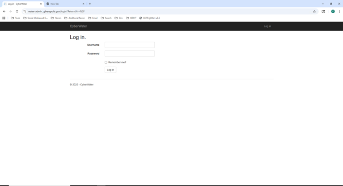
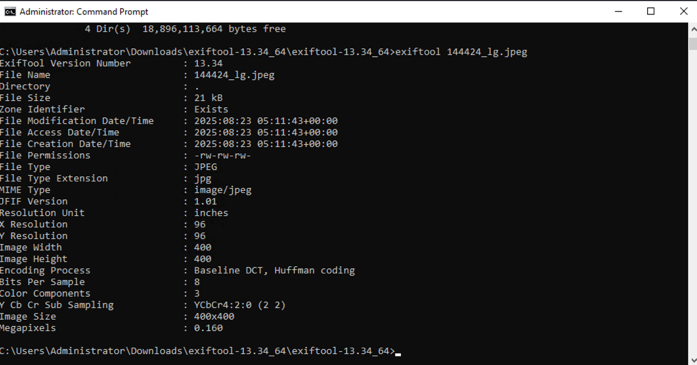
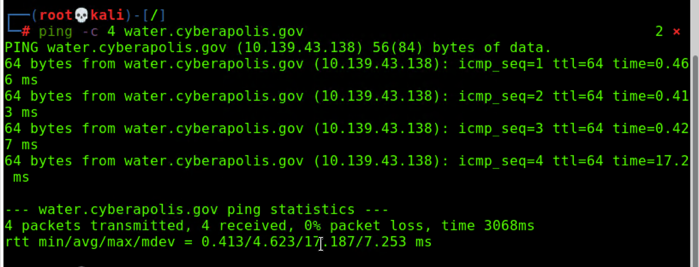
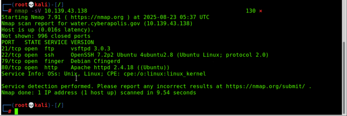
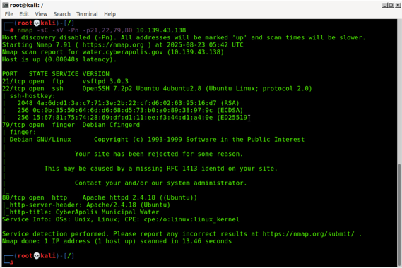
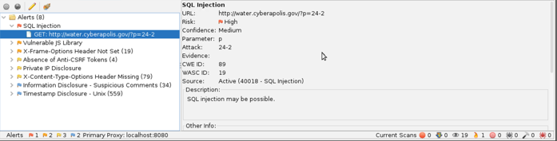
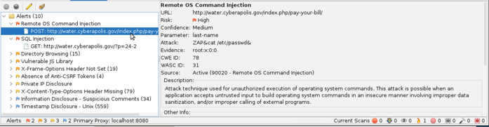
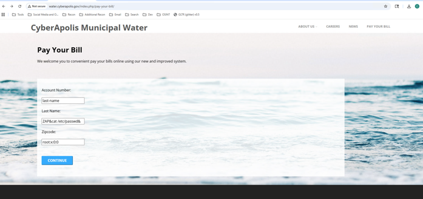
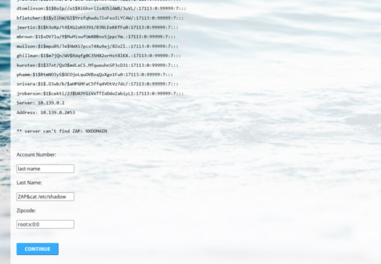
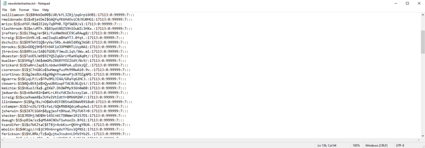

# CyberApolis Water: Red Team Assessment

**Devante Metoyer · August 2025**

> **Scenario:** CyberApolis is a *fictional* city on an isolated cyber training range. All people, organizations, domains and IP addresses below are simulated. No real systems were tested.

## Executive Summary

In response to a hostile takeover of the CyberApolis Water Company by the Carbon Spector terrorist organization, the Department of Homeland Security (DHS) initiated a red team engagement to regain control of the dam’s flood gates and neutralize the threat to the city of CyberApolis. This operation successfully identified and exploited critical security weaknesses, establishing command execution on the water company's public web server and extracting its local password hashes.

During the engagement, we followed the standard penetration testing methodology, beginning with reconnaissance and moving through scanning, exploitation, and post-exploitation. OSINT techniques revealed employee contact details, usernames, and metadata from social media accounts and profile pictures hosted on ChirpyHub. Phone numbers and usernames were then used to cross-reference accounts using tools like WhatsMyName.

The scanning phase included both active and passive scans. Nmap was utilized for SYN, version, and OS detection scans. These scans exposed open ports and potential attack surfaces, while ZAP scanning highlighted web application vulnerabilities on the employee portal and control interfaces.

During the exploitation phase, I leveraged known vulnerabilities in outdated or misconfigured web applications, allowing access to sensitive files such as /etc/shadow. Password hashes for every local account were extracted from this file for offline cracking.

The Major Vulnerabilities Identified were:

  - Remote OS Command Injection: A critical vulnerability was discovered in the “Last Name” field of the index.php/pay-your-bill form, which permitted arbitrary operating system commands to be executed. DHS confirmed the vulnerability by injecting the payload ZAP\&cat /etc/passwd&, successfully retrieving sensitive system files.

  - SQL Injection: A separate injection vulnerability was discovered in the GET parameter p of the URL index.php?p=24-2, where malicious SQL queries could be executed.

  - Insecure file permissions: the low-privileged web server account (www-data) could read /etc/shadow.

  - Insecure web application endpoints: Lack of input validation and outdated software allowed access to protected areas.

  - No rate-limiting or brute-force protection: Portals were susceptible to password spray and dictionary attacks.

Recommendations and Mitigations:

  - Enforce strong password policies and require multi-factor authentication.

  - Sanitize all uploaded media to remove embedded metadata.

  - Patch and update all web applications, frameworks, and libraries.

  - Implement access controls and monitoring on critical endpoints.

  - Deploy WAF and intrusion detection systems to prevent brute-force attempts and log anomalies.

These vulnerabilities present a high risk to operational continuity and public safety. Remediation efforts should be prioritized according to potential impact on the water infrastructure and surrounding communities.

## Introduction

As a penetration tester assigned to the Department of Homeland Security (DHS) Cybersecurity and Infrastructure Security Agency (CISA), I conducted a structured red team engagement against CyberApolis Water, a simulated critical infrastructure environment modeled after U.S. municipal water authorities. The purpose of this engagement was to assess the security posture, identify exploitable vulnerabilities, and evaluate the potential impact of cyber intrusions across operational and information systems supporting water distribution and control.

This test supports DHS’s broader mission to secure critical infrastructure under Presidential Policy Directive 21 (PPD-21) and aligns with the National Infrastructure Protection Plan (NIPP). Engagement was conducted under controlled conditions in accordance with DHS red team protocols and NIST SP 800-115 guidelines. All activities were pre-approved and limited to the authorized test environment to ensure safety and containment of actions.

The remainder of this report documents each phase of the engagement: Reconnaissance, Scanning, Exploitation, Post-Exploitation, and Recommendations. Each section details tools and techniques used, findings and severity ratings, and an assessment of risk to the confidentiality, integrity, and availability of the target environment. This report is intended to support leadership in understanding the cyber risk landscape facing the water sector and guide future hardening initiatives.

**  
**

## Reconnaissance

The reconnaissance phase of this engagement began with passive information gathering on the simulated organization, CyberApolis Water. As a first step, open-source intelligence (OSINT) techniques were applied to map the organization’s digital footprint. The landing page of the CyberApolis Water portal provided a gateway to various internal systems and immediately revealed connections to employee portals and login services (Figure 9). This initial view helped define possible entry points for further probing.

Using the content from the homepage, several key insights were gathered. Most notably, unique employee ID numbers were found embedded in the portal interface (Figures 1–8, redacted). These identifiers are likely used in authentication processes and may be leveraged in subsequent enumeration or credential stuffing phases. The presence of these IDs provided insight into the structure of user management and supported the creation of a target list.

The next stage involved reconnaissance across public social platforms. ChirpyHub, a simulated social media platform, was instrumental in identifying the entire list of CyberApolis Water employees. Each discovered employee profile included usernames, profile pictures, and in many cases, links to other platforms or personal identifiers (Figure 10). All images were downloaded and examined using exiftool to search for embedded metadata. Although many images were sanitized, a few retained geolocation and device model data, which may support further analysis.

Usernames gathered from ChirpyHub were also entered into the whatsmyname.app service to correlate aliases across multiple platforms (Figure 4). This correlation allowed the red team to build a fuller picture of digital identities and determine whether these accounts reused usernames or posted publicly available data elsewhere.

Phone numbers found during the OSINT process were also noted for potential use in SMS phishing (aka smishing) or MFA bypass attacks. While not exploited directly during reconnaissance, their presence highlighted a potential social engineering vector worth evaluating later in the engagement.

Collectively, the reconnaissance phase revealed a robust surface for further exploitation and laid the groundwork for targeted scanning and enumeration efforts. Each piece of data collected supports later stages of the penetration test, while also representing a real-world threat to organizations that fail to monitor their public-facing digital footprint.

> **Figures 1–8 (redacted):** eight employee profile cards (name, title, direct phone number) were enumerated from the public site. The images are omitted here because the scenario uses stock photos of real people and real-format phone numbers.

Figure 9  
*CyberApolis Water: Employee Portal*

Figure 10  
*Social media usernames (redacted — simulated personas shown with stock-photo thumbnails)*

Figure 11  
*CyberApolis Water: Employee Photo Metadata*

Figure 12  
*CyberApolis Water: Public IP Address*

Figure 13  
*CyberApolis Water: Nmap SYN/Version/OS Scan*

Figure 14  
*CyberApolis Water: SQL Injection*

Figure 15  
*CyberApolis Water: Remote OS Command Injection*

Figure 16  
*CyberApolis Water: Employee Portal Injection*

Figure 17  
*CyberApolis Water: Employee Password Hashes*

## Scanning

### Heading Descriptions

Nmap is an open-source utility used to perform network discovery and security auditing. For this engagement, three scan types were used: SYN scan, Version Detection scan, and OS Detection scan. These scans were launched against the public-facing IP address discovered during reconnaissance (Figure 13).

### Nmap Scans

Nmap is an open-source tool used for network discovery and security auditing. It scans hosts and networks to identify live systems, open ports, running services, and operating system details. Nmap is commonly used by system administrators and cybersecurity professionals for tasks like vulnerability assessment, network inventory, and firewall testing.

#### Nmap SYN Scan (10.139.43.138)

The initial scan performed against the target, CyberApolis Water (10.139.43.138), was an Nmap TCP SYN scan (-sS). This is a type of "stealth" scan that determines port status without completing the full TCP three-way handshake, making it fast and less likely to be logged by traditional security systems. It was used to quickly identify all open TCP ports on the server.

The scan revealed four open ports, indicating the primary services exposed to the internet:

Port 21 (FTP): File Transfer Protocol, used for transferring files.

Port 22 (SSH): Secure Shell, used for secure remote administration.

Port 79 (Finger): An outdated protocol used to retrieve user information.

Port 80 (HTTP): Hypertext Transfer Protocol, indicating a web server is running.

#### Nmap Version Scan (10.139.43.138)

Following the SYN scan, a Version Detection scan (-sV) was conducted to probe the open ports and identify the specific software and version numbers of the running services. This is a critical step for identifying potentially outdated and vulnerable software.

The version scan provided the following detailed information:

FTP: vsftpd 3.0.3

SSH: OpenSSH 7.2p2 Ubuntu 4ubuntu2.8

Finger: Debian Cfingerd

HTTP: Apache httpd 2.4.18 ((Ubuntu))

The key finding from this scan is that all identified services are running significantly outdated versions. For example, Apache 2.4.18 was released in 2015 and has numerous known vulnerabilities.

#### Nmap OS Scan (10.139.43.138)

To further profile the target, an OS Detection scan (-O) was performed. This scan sends a series of specialized probes and analyzes the responses to create an accurate fingerprint of the underlying operating system. Knowing the OS is crucial for tailoring exploits and post-exploitation techniques.

The scan confirmed that the server is running a Linux operating system, specifically a version with a 3.x kernel (estimated between 3.10 and 3.13). This information, combined with the service versions, strongly indicates the target is an older Ubuntu Linux distribution.

### ZAP Scan (water.cyberapolis.gov)

An application-layer scan was conducted using the OWASP ZAP (Zed Attack Proxy) tool. ZAP automatically crawled the target website and launched a series of tests against its pages and parameters to discover common web application vulnerabilities.

The ZAP scan identified two critical, high-risk vulnerabilities:

  - SQL Injection (High Risk): ZAP detected a potential SQL Injection vulnerability in the p parameter of the main URL. If exploitable, this could allow an attacker to bypass authentication and read, modify, or delete data from the application's database.

  - Remote OS Command Injection (High Risk): ZAP discovered a command injection vulnerability in the last-name parameter of the "Pay Your Bill" page. This is a critical flaw that allows an attacker to execute arbitrary commands directly on the server's operating system, as detailed in the Exploitation section of this report.

## Exploitation

This phase of the engagement focused on leveraging the critical vulnerabilities identified during scanning to gain unauthorized access, enumerate the compromised system, and exfiltrate sensitive data. The primary target was the Remote OS Command Injection vulnerability discovered in the water.cyberapolis.gov web application. The successful exploitation of this single flaw provided the necessary foothold to achieve a full compromise of the server's user data.

The Remote OS Command Injection vulnerability in the "Pay Your Bill" page was confirmed to be exploitable. The last-name parameter in the payment form was identified as the injection point, allowing shell metacharacters to be passed directly to the underlying server's operating system for execution.

A proof-of-concept payload was crafted to test this flaw: ZAP\&cat /etc/passwd&. This payload was submitted via the "Last Name" field. The server executed the cat /etc/passwd command and returned the first line of the file, root:x:0:0, which was reflected in the "Zipcode" field on the page. This test provided definitive confirmation of the vulnerability and granted the ability to execute commands as the web server user (www-data). (Figure 15)

Once a reliable method of command execution was established, the next step was to learn more about the compromised system and its environment. File System Discovery: The command ls -la /etc was injected to list the contents of the /etc directory. This revealed key system configuration files and confirmed the attacker's ability to explore the server's file system.

Application Analysis: By reading the contents of index.php, the web application was identified as running on the WordPress framework. This discovery is significant, as it opens up further attack avenues related to known WordPress vulnerabilities, insecure plugins, or misconfigurations.

The primary objective of the post-exploitation phase was to escalate privileges by obtaining user credentials. The command injection vulnerability was leveraged to access and exfiltrate critical system authentication files.The /etc/shadow file, which contains the hashed passwords for all local users, was successfully read from the server using the payload ZAP\&cat /etc/shadow. The ability of the web server user (www-data) to read this file indicates a severe system misconfiguration, as this file should only be accessible by the root user. The entire contents of the shadow file were exfiltrated and saved locally to a file named newstolenhashes.txt. This action successfully provided the means to conduct an offline password cracking attack to recover the plaintext passwords for all system users.

(Figure 17)

## Summary and Mitigations

This engagement successfully simulated a full-chain attack against CyberApolis Water, revealing several interconnected security weaknesses that culminated in the complete compromise of the web server’s user data. The most critical weakness was a Remote OS Command Injection vulnerability in the "Pay Your Bill" application, which allowed for arbitrary command execution by failing to properly sanitize user-supplied input (OWASP, 2021). The impact of this flaw was compounded by insecure file permissions, which permitted the web server's low-privileged user to read the /etc/shadow file and exfiltrate all local user password hashes. Furthermore, the server’s attack surface was unnecessarily large due to outdated and vulnerable services, including old versions of Apache and OpenSSH with numerous known exploits. This risk was amplified by information disclosure through a public employee directory and an active Finger service, which aided in enumerating potential user accounts. Finally, the web application scanner also flagged a potential SQL Injection vulnerability, which, if exploited, could lead to the compromise of the customer database (OWASP, 2021).

To address these critical findings, a multi-layered mitigation strategy is required. The immediate priority is to remediate the command injection and potential SQL injection flaws by implementing server-side input validation and using parameterized queries for all database interactions. While a Web Application Firewall (WAF) can provide a rapid, temporary defense, it should not be the sole control as it can often be bypassed (OWASP, 2019). Architecturally, the principle of least privilege must be enforced by correcting file permissions to prevent the web user from reading sensitive files like /etc/shadow. Operationally, CyberApolis Water must implement a formal patch management program to update its outdated services and reduce its exposure to known vulnerabilities. Procedurally, the organization should disable the Finger service and review the business need for a public employee directory to minimize information disclosure.

#### Next steps (not performed in this report)

1. Crack the exfiltrated hashes offline (e.g., John the Ripper) to recover plaintext credentials.
2. Test recovered credentials against the Employee Portal and the HMI (control panel) interfaces.
3. Use valid HMI credentials to reach the industrial controls and complete the scenario objective (closing the flood gates).

Metadata analysis of employee photos was performed but was not needed for the attack path.

## References

- National Institute of Standards and Technology. (2008). *Technical guide to information security testing and assessment* (NIST SP 800-115).
- OWASP Foundation. (2021). *OWASP Top 10:2021, A03 Injection.* https://owasp.org/Top10/A03_2021-Injection/
