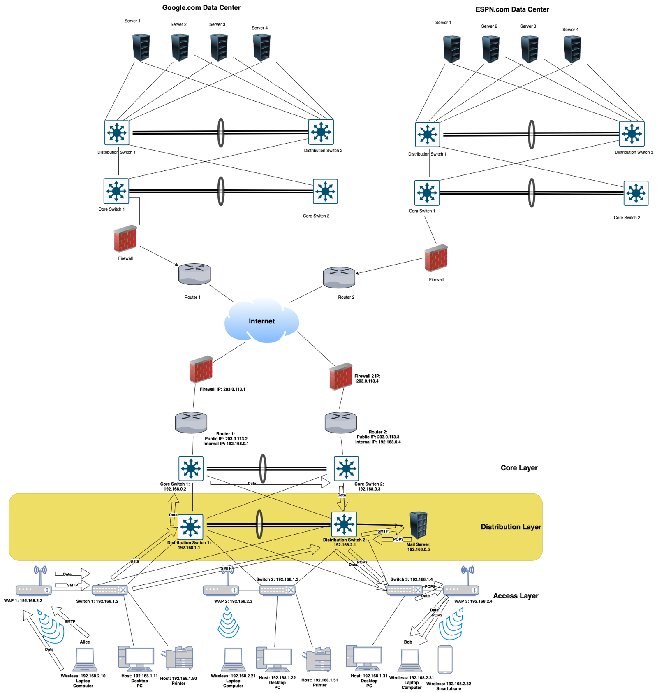

# Tracing a Packet Through the OSI and TCP/IP Layers

*Devante Metoyer · Spring 2024*

## The 3 Tier Network Architecture Design

## Resource Request the Layers
Alice decides to send an email to Bob using her email client (1), which supports Multipurpose Internet Mail Extensions (2) for attaching files. She composes her email and clicks send, which triggers SMTP authentication (3) using her credentials to ensure the email is sent securely through SSL/TLS encryption (4). The email is handled over SMTP, which uses TCP (6) for reliable delivery, identifying the correct application process via SMTP’s standard port 25 (8). Once the email client sends the email, it moves through Alice’s local network starting from her connected switch (16) which uses Ethernet (16) protocols to transport the frame. The email packet, identified by its MAC address (17), is forwarded to the distribution switch (16) and reaches the core switch (16) which directs it towards the router (12). This router employs NAT (14) to translate the private IP address to a public one and uses IP routing (12) to determine the best path to send the packet through the internet. The packet exits Alice’s local network through the firewall (5) where security policies are verified before being allowed onto the internet (15). It travels through various network nodes using IPv4 addressing (15) until it reaches Bob's ISP and eventually his home network. Upon arrival at Bob's network, the packet passes through his firewall (5) and router (12) which uses IPv4 and routing protocols to direct the packet to his local network. The core switch (16) in Bob’s network receives the packet and, through switching (18), directs it to the appropriate segment on Bob's VLAN (19), ensuring that it reaches his personal computer securely and efficiently. Bob’s computer, connected wirelessly (20), receives the packet through his local access point (20). His email client retrieves the email from the server using IMAP (5), which keeps the message on the server allowing Bob to access it from any device. Throughout this journey, TCP's role (6) ensures that the segments are delivered in order and intact, managing any potential network congestion (10) effectively. This comprehensive process encapsulates the layered complexities of networking technologies, ensuring that Alice's email reaches Bob securely and efficiently.

## Attacks from the AL
Session hijacking is a sophisticated security threat occurring predominantly at the Application Layer, where unauthorized individuals gain control over a web session by exploiting session tokens. These tokens are essential for user interactions on websites, ensuring continuity and security by serving as unique session identifiers. The process typically begins with the attacker acquiring the session ID through various techniques such as brute force, sniffing network traffic, or exploiting web vulnerabilities like cross-site scripting (XSS). The core objective of session hijacking is to compromise the confidentiality, integrity, and availability of user data, which aligns directly with undermining the CIA triad. Attackers could access sensitive information, modify account details, or disrupt service availability, leading to potential identity theft, fraud, or a significant loss of trust in the service (Baitha & Vinod, 2018; Kumar, 2024).

The vulnerabilities most commonly exploited in session hijacking include poor session management practices, such as insecure transmission and storage of session IDs, predictable session token generation, and inadequate session validation and timeout policies (Kumar, 2024). To mitigate such attacks, it is imperative for organizations to implement stringent session management protocols. Recommended strategies include securing communications across all website pages using HTTPS, generating secure and unpredictable session IDs, enforcing strict session expiration policies, and initiating session ID regeneration after successful user authentication. Furthermore, setting HTTP-only flags on session cookies can prevent them from being accessed through client-side scripts, offering a robust defense against XSS attacks. Regular monitoring and auditing of session-related activities are also crucial, allowing for the timely detection and response to potential security breaches. Implementing multi-factor authentication can further secure login processes, significantly reducing the vulnerability to session hijacking (Baitha & Vinod, 2018; Kumar, 2024)

## Attacks from the TL
Port scanning is a technique used at the Transport layer of the TCP/IP stack, involving the probing of a server's or host's ports to discover which are open and listening, indicating active services or applications. This attack is typically carried out using tools such as Nmap, Nessus, or Netcat, which automate the sending of packets to specific ports on a host. The scanner observes the responses to determine the status of each port—open, closed, or filtered. The primary goal of port scanning is to identify open ports and the services associated with them, thereby compiling a profile of the target's network defenses. This activity primarily threatens the CIA triad by potentially compromising the confidentiality of sensitive information, the integrity through unauthorized access and data manipulation, and the availability of services, sometimes causing crashes due to resource exhaustion. Port scanning exploits vulnerabilities inherent in the necessary function of ports being open for legitimate services. To mitigate this risk, I recommend that senior management implement strict firewall rules to restrict unauthorized traffic, utilize Intrusion Detection Systems (IDS) or Intrusion Prevention Systems (IPS) to detect and counteract port scanning activities, keep all software updated to close security vulnerabilities, conduct regular security audits and penetration testing, and employ network segmentation to restrict access to sensitive network segments. These measures will enhance the organization's defenses against port scanning and similar network reconnaissance activities (Kurose & Ross, p. 347).

## Attacks from the IL
Routing Table Poisoning is a sophisticated cyberattack that targets the Internet layer of the TCP/IP stack, deliberately manipulating router routing tables by introducing fraudulent routing information. This type of attack exploits inherent vulnerabilities in routing protocols such as RIP (Routing Information Protocol) or OSPF (Open Shortest Path First), which often lack adequate authentication measures and automatically trust incoming routing updates. By sending deceptive route updates to routers, attackers can alter the network's routing tables, causing routers to send network traffic along incorrect or less efficient paths. The attack's primary objective is to compromise the three key elements of the CIA triad: confidentiality, integrity, and availability of network data and services. Confidentiality is jeopardized when maliciously rerouted traffic is directed through an attacker-controlled router, allowing for potential data interception. Integrity is threatened as this diverted traffic can be altered or manipulated, and availability is impacted by disrupting network services, potentially leading to a denial of service for legitimate users. This attack capitalizes on the trust model and the absence of robust authentication in routing updates within network protocols. To defend against routing table poisoning, network administrators are advised to secure routing updates with strong authentication mechanisms and implement cryptographic techniques to ensure the integrity and authenticity of routing messages. Route filtering can also be employed to accept updates only from known, verified sources. Additionally, deploying intrusion detection systems (IDS) that can identify suspicious routing activities and routine audits of routing tables and configurations can help in quickly detecting and mitigating such attacks. Ensuring these protective measures are in place will significantly enhance network resilience against routing table poisoning, maintaining the network's reliability and security (Computer Networks -II, p. 121).

## Attacks from the NAL
VLAN Hopping is a network attack primarily aimed at the Network Access layer of the TCP/IP stack, though it exploits vulnerabilities inherent in the configuration of devices operating at both the Network Access and Internet layers. This attack enables an attacker to bypass Layer 2 hardware and protocol isolation by sending traffic from one VLAN to another, which should not normally be accessible. Typically, VLAN Hopping is carried out in one of two ways: by exploiting an improperly secured switch port configured to automatically negotiate trunking (using the Dynamic Trunking Protocol or DTP), which allows the attacker to configure their own connection as a trunk link to access multiple VLANs; or through the use of a double tagging technique where the attacker sends frames encapsulated with two VLAN tags—the outer tag is stripped by the first switch, and the inner tag routes the frame to a target VLAN.

The objective of VLAN Hopping is to compromise data integrity and availability, part of the CIA (Confidentiality, Integrity, and Availability) triad. By gaining access to multiple VLANs, an attacker can intercept sensitive data, perform unauthorized operations, or disrupt service across the network segments, thereby breaching the integrity and availability of the network's data and services.

VLAN Hopping exploits the vulnerability associated with the automatic configuration of switch ports to accept VLAN tagging and trunking without adequate security verification. To mitigate this risk, it is recommended that organizations disable DTP on all user-access ports and manually configure necessary trunk connections. Furthermore, it's essential to ensure proper VLAN separation and to secure all switch ports with appropriate VLAN ID configurations, preventing any unauthorized attempts to assign VLAN tags to data frames. Educating senior management about these measures will emphasize the critical nature of these configurations in preserving network security and integrity (Aref, 2019).

## Conclusion
In summary, we examine network attacks across the TCP/IP stack, highlighting unique threats and mitigation strategies for each layer. Session hijacking at the Application Layer, port scanning at the Transport Layer, routing table poisoning at the Internet Layer, and VLAN hopping at the Network Access Layer exploit specific vulnerabilities, threatening the confidentiality, integrity, and availability of data. Effective countermeasures include enforcing HTTPS, using firewalls and intrusion detection systems, securing routing updates, and disabling Dynamic Trunking Protocol on all ports. Understanding and implementing these security measures are crucial for protecting network integrity and ensuring robust defense against various cyber threats.**  
**

## References
Kurose, J., & Ross, K. (2021). *Computer Networking: Eighth Edition*. O'Reilly.

Baitha, A., & Vinod, S. (2018). *Session Hijacking and Prevention Technique.* International Journal of Engineering and Technology, 7(2.6), 193-198. https://www.researchgate.net/profile/Anuj-Baitha-2/publication/325117343\_Session\_Hijacking\_and\_Prevention\_Technique/links/5c1a0e8c458515a4c7e9028f/Session-Hijacking-and-Prevention-Technique.pdf.

Kumar, D. (2024). *How to Prevent Session Hijacking?* Baeldung. https://www.baeldung.com/cs/session-hijacking

Klepper, M. (2022). *Top 12 client-side security threats.* AT\&T. https://cybersecurity.att.com/blogs/security-essentials/top-12-client-side-security-threats.

Aref (2019). *VLAN1 and VLAN Hopping Attack.* Cisco. https://learningnetwork.cisco.com/s/blogs/a0D3i000002SKPREA4/vlan1-and-vlan-hopping-attack?dtid=osscdc000283.

Unknown. *Routing Table Poisoning Attacks and DNS Hacking Attacks.* Computer Networks-II. https://elearningatria.wordpress.com/wp-content/uploads/2013/10/cse-vi-computer-networks-ii-10cs64-notes.pdf
